---
title: Externalized Data, Selective Retrieval, and Large-Artifact Editing for LLM Agents
subtitle: Research note for Tanit path tools
description: Keep bulk state outside the model. Retrieve only the evidence needed for reasoning, and let tools manipulate the bulk data directly.
summary: Keep bulk state outside the model. Retrieve only the evidence needed for reasoning, and let tools manipulate the bulk data directly.
date: 2026-10-03
status: research
language: en
toc: true
tags:
  - tanit
  - llm-agents
  - retrieval
  - filesystem
  - file-compose
  - file-patch
---

# Externalized Data, Selective Retrieval, and Large-Artifact Editing for LLM Agents

## Overview

A recurring problem in tool-using LLM agents is that the useful working set may be much larger than the model context that should economically or practically be consumed.

This appears in several forms:

- large repositories;
- long-running research sessions;
- large document collections;
- CLI tools producing hundreds of kilobytes or megabytes of output;
- generated reports;
- Office document extraction;
- logs and build output;
- large source files;
- multi-source document assembly.

A common architectural answer is emerging:

> Keep bulk state outside the model. Retrieve only the evidence needed for reasoning, and let tools manipulate the bulk data directly.

For Tanit, this suggests a tool flow such as:

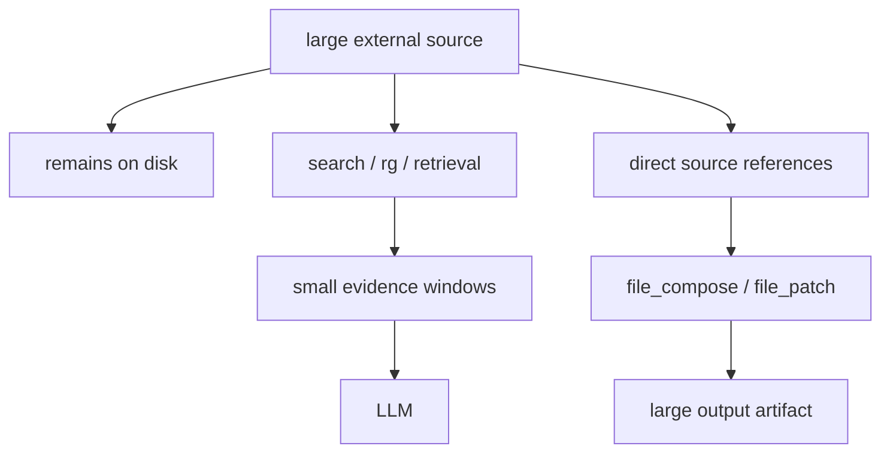

The key distinction is:

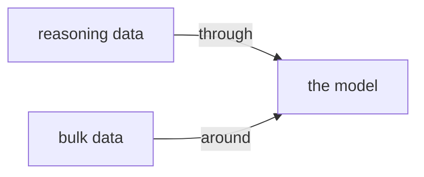

The research below supports different parts of this architecture.

---

# 1. Filesystem-Based Memory for LLM Agents

**Sizhe Zhou et al., 2026**

*Filesystem-Based Memory for LLM Agents: Organization, Evolution, and Sustainability*

This work directly studies the now-common pattern of agents storing long-term state as directories of files that the agent reads, writes, searches, and reorganizes using ordinary filesystem tools.

The paper compares:

- agent-organized filesystem hierarchies;
- verbatim memory dumps;
- chunk-based retrieval;
- different search toolsets;
- different management and search agents.

One important result is that organization does not automatically improve answer quality, but it can substantially improve **retrieval economy**.

The authors report that organized stores can roughly halve retrieval cost when the stored material becomes large.

The work also finds that the available tools themselves strongly influence how the filesystem evolves. Changing the tool harness can alter the resulting memory organization about as much as changing the model.

This is particularly relevant to Tanit because it means that tools such as:

```text
file_search
file_read
file_glob
file_compose
file_patch
```

are not merely implementation details.

Their affordances affect how the agent uses external state.

### Relevance to Tanit

This supports the principle that large information stores should remain externally organized while the model accesses only relevant portions.

It also supports investing in precise filesystem primitives rather than assuming that a larger context window solves the problem.

Reference: [Zhou et al., 2026](https://arxiv.org/abs/2607.26637).

---

# 2. FS-Researcher

**Chiwei Zhu et al., 2026**

*FS-Researcher: Test-Time Scaling for Long-Horizon Research Tasks with File-System-Based Agents*

FS-Researcher addresses long research tasks whose trajectories exceed model context limits.

Instead of continually carrying the entire research process inside the context window, it uses a persistent filesystem workspace.

Its architecture separates two roles:

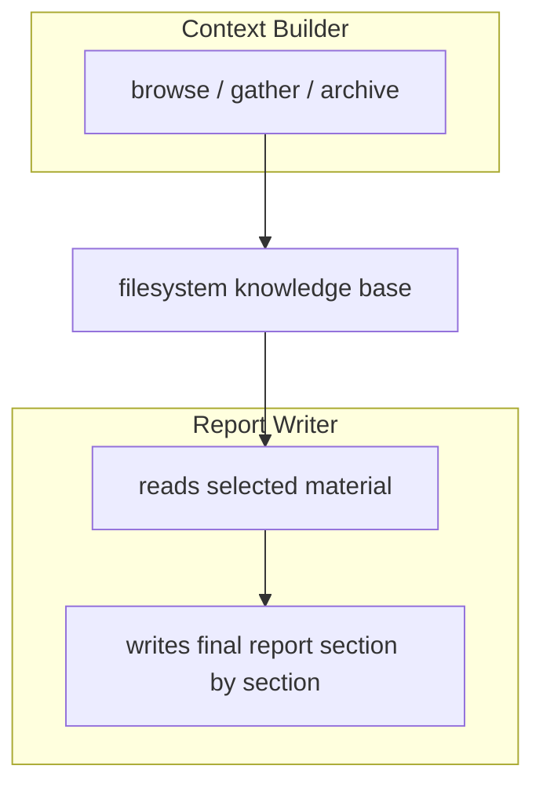

The filesystem serves both as:

- durable external memory;
- shared coordination medium.

The system can therefore continue gathering evidence even when the total accumulated research material is much larger than the model's immediate context.

The final writer does not need every raw source loaded at once.

### Relevance to Tanit

This is very close to the intended large-document workflow:

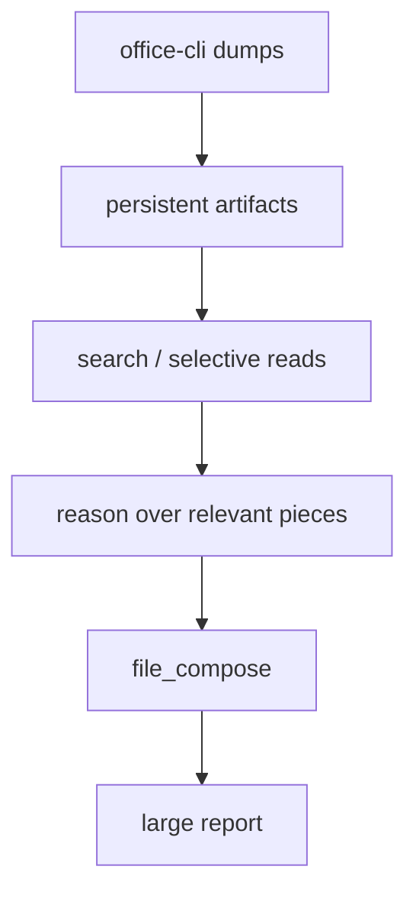

The important point is that filesystem persistence enables **test-time scaling without corresponding context growth**.

Reference: [Zhu et al., 2026](https://arxiv.org/abs/2602.01566).

---

# 3. SMFS — Memory as a Filesystem

**Prasanna AP, Soham Daga, Dhravya Shah, 2026**

*SMFS: Memory as a Filesystem*

SMFS combines filesystem semantics with semantic retrieval.

Its motivation is that pure filesystem navigation and pure vector retrieval each have shortcomings.

Filesystem navigation gives:

- stable paths;
- structure;
- familiar shell operations;
- incremental reads.

Semantic retrieval gives:

- meaning-based lookup;
- better discovery across large corpora.

SMFS exposes memory as a filesystem while adding semantic retrieval through familiar operations such as `grep`.

The report emphasizes a problem especially relevant to tool-result budgeting:

> Retrieval itself can become expensive when an agent repeatedly loads paths, partial reads, and overlapping chunks into context.

Their reported evaluation measures token consumption directly and reports substantial reductions in total tokens and tokens per correct answer compared with a filesystem-only baseline on their benchmark.

The report gives a useful framing:

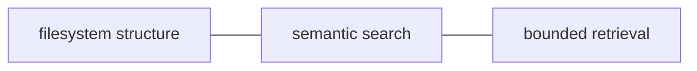

rather than treating any one mechanism as sufficient.

### Relevance to Tanit

This reinforces the idea that `rg` / exact search, semantic recall, and selective `file_read` are complementary.

The goal should not be:


but:


Reference: [Prasanna, Daga, and Shah, 2026](https://smfs.ai/research/memory-as-a-filesystem/).

---

# 4. CoRet

**Fabio James Fehr et al., ACL 2025**

*CoRet: Improved Retriever for Code Editing*

CoRet focuses specifically on retrieving relevant repository sections for code-editing tasks.

Its retriever incorporates:

- semantic information;
- repository structure;
- call-graph dependencies.

The retrieved chunks can then be passed to a code-editing model or agent.

The authors report at least a 15 percentage-point improvement in retrieval recall over comparison systems on the evaluated bug-localization datasets.

The central design is important:

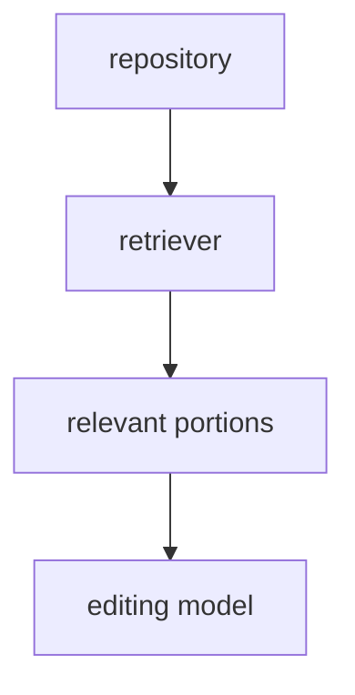

not:

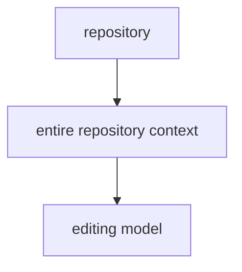

### Relevance to Tanit

This maps directly onto:

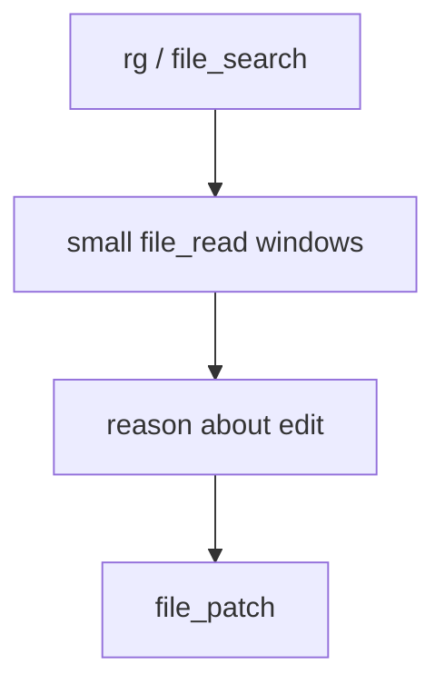

The LLM should identify and understand the affected region.

It should not transport the entire surrounding repository through context.

Reference: [Fehr et al., ACL 2025](https://aclanthology.org/2025.acl-short.62/).

---

# 5. RepoCoder

**Fengji Zhang et al., EMNLP 2023**

*RepoCoder: Repository-Level Code Completion Through Iterative Retrieval and Generation*

RepoCoder addresses repository-level code completion using an iterative retrieval-generation process.

Rather than retrieving context once, it alternates:

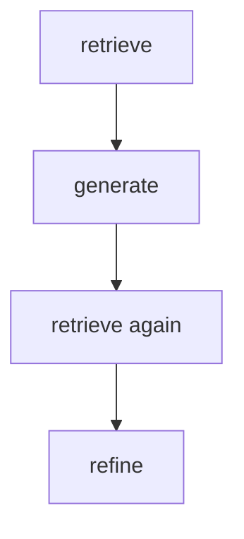

The system therefore progressively discovers useful repository context.

The authors report that this iterative approach improves substantially over an in-file baseline and consistently outperforms their vanilla retrieval-augmented code-completion setup.

### Relevance to Tanit

This supports making retrieval cheap and repeatable rather than attempting to predict the perfect context window in one operation.

For example:

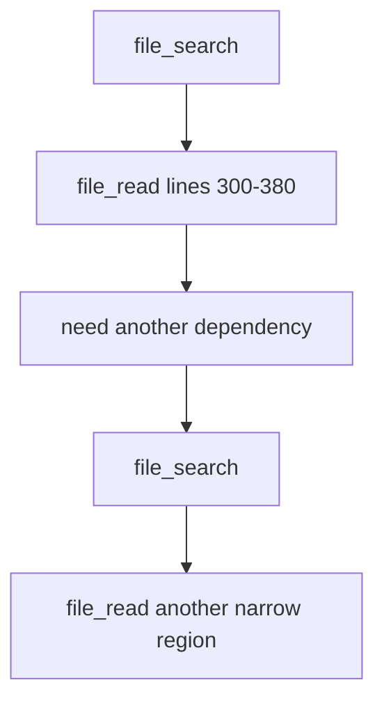

Repeated narrow retrieval is preferable to one large speculative read.

Reference: [Zhang et al., EMNLP 2023](https://aclanthology.org/2023.emnlp-main.151/).

---

# 6. RETRO

**Sebastian Borgeaud et al., 2021/2022**

*Improving Language Models by Retrieving from Trillions of Tokens*

RETRO is not a filesystem-agent system, but it establishes the broader principle of explicit external memory.

The model retrieves relevant document chunks from a corpus containing trillions of tokens rather than embedding all relevant knowledge into the immediate model input or parameters.

Its central idea can be summarized as:

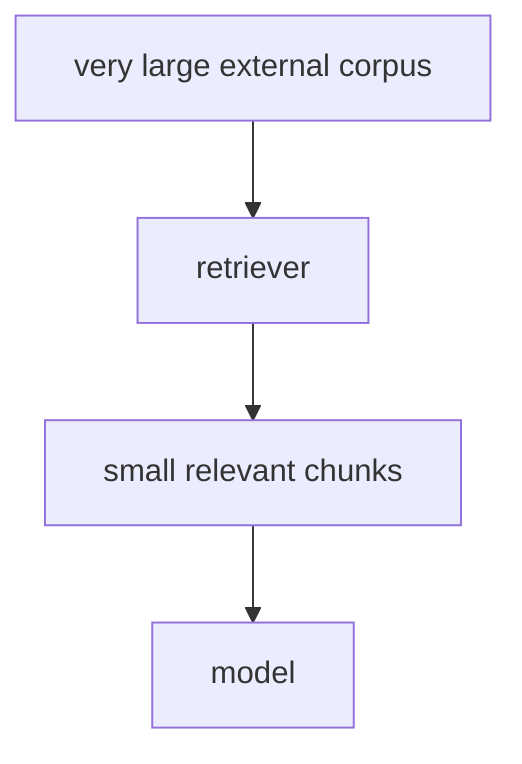

The external corpus can be vastly larger than the model's active context.

### Relevance to Tanit

The same principle applies operationally:


The artifact is external state.

Only selected pieces should cross the reasoning boundary.

Reference: [Borgeaud et al., ICML 2022](https://arxiv.org/abs/2112.04426).

---

# 7. Toolformer

**Timo Schick et al., NeurIPS 2023**

*Toolformer: Language Models Can Teach Themselves to Use Tools*

Toolformer examines models learning when and how to invoke external tools through APIs.

Its tools include operations such as:

- search;
- arithmetic;
- translation;
- question answering;
- calendar access.

The broader architectural implication is that models do not need to internally perform every operation when a specialized external system can execute it more efficiently or reliably.

### Relevance to Tanit

This provides a general rationale for specialized filesystem operations such as:

```text
file_search
file_read
file_patch
file_compose
```

instead of reducing every filesystem task to text generation.

A tool such as `file_compose` can perform bulk byte movement deterministically while the model only specifies the intended composition.

Reference: [Schick et al., NeurIPS 2023](https://arxiv.org/abs/2302.04761).

---

# Implications for Large Tool Results

The research suggests treating tool outputs as externally addressable artifacts rather than assuming that every output must become model context.

For example:

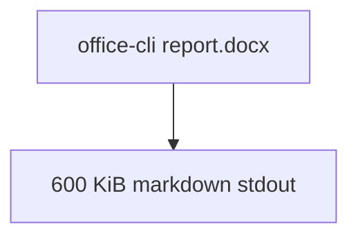

should not necessarily produce:

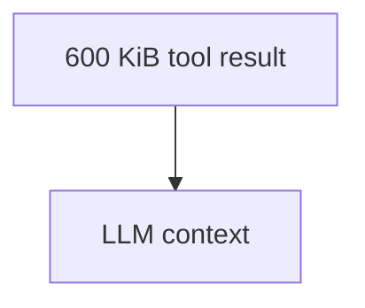

Instead:

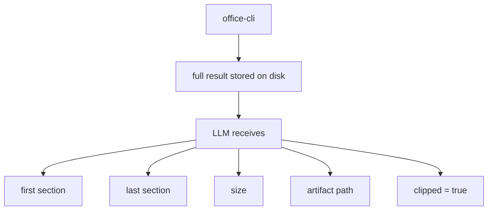

The agent can then use:

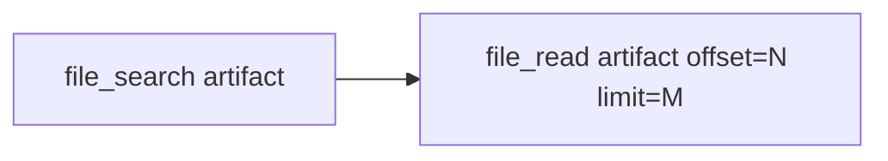

as required.

This makes the filesystem an **external working memory and bulk-data transport layer**.

---

# Implications for `rg`

`ripgrep` is particularly important because it can scan enormous datasets extremely cheaply.

The expensive resource is not the search itself.

The expensive operation is:

> turning thousands of matches into LLM input.

The appropriate flow is therefore:

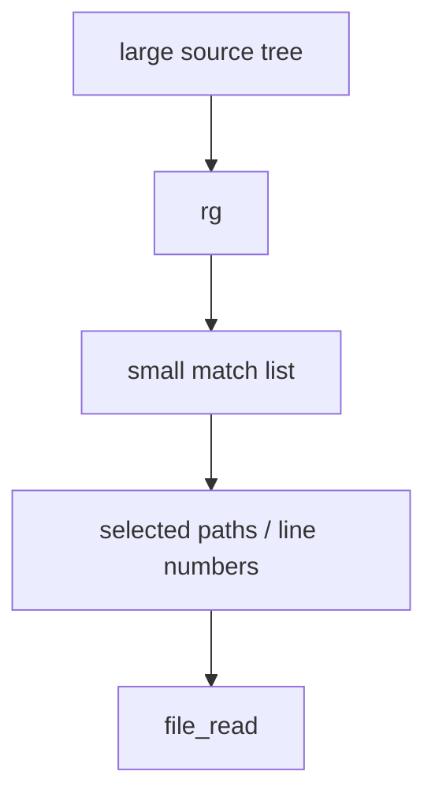

not:

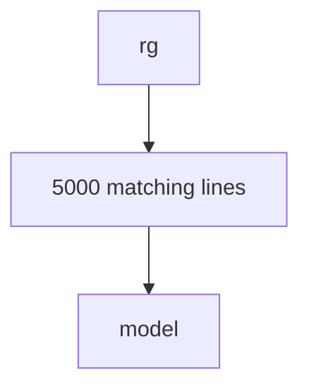

Search result count and LLM result size should consequently be independent constraints.

For example:

```text
search collection limit:
    500 matches

LLM serialized result budget:
    32 KiB
```

A fast backend does not justify an unbounded result envelope.

---

# Implications for Large File Editing

The same principle applies on the output side.

Suppose the agent needs to create:

```text
compiled-report.md
```

from three large source documents.

A naive pipeline is:

```mermaid
flowchart TD
  a[read source A] --> ca[LLM context]
  ca --> b[read source B]
  b --> cb[LLM context]
  cb --> c[read source C]
  c --> cc[LLM context]
  cc --> repro[LLM reproduces all text]
  repro --> write[write_file]
```

This makes the LLM act as an extremely expensive byte-copy mechanism.

A better architecture is:

```mermaid
flowchart LR
  a[source A] --> compose[file_compose]
  b[source B] --> compose
  c[source C] --> compose
  compose --> out[compiled-report.md]
```

The model sends only a recipe:

```json id="pdh33c"
{
  "parts": [
    {"type":"file","path":"a.md"},
    {"type":"file","path":"b.md"},
    {"type":"file","path":"c.md"}
  ]
}
```

The host copies the bytes directly.

---

# `file_compose` as Write-Side Retrieval

Retrieval research largely concentrates on solving the read-side problem:

> How can an LLM consume useful information from a corpus that is much larger than its context?

`file_compose` addresses the corresponding write-side problem:

> How can an LLM create a large artifact containing existing material without generating that material again?

These are symmetrical problems.

Read side:

```mermaid
flowchart TD
  corpus[large corpus] --> refs["retrieve references / ranges"]
  refs --> ctx[small model context]
```

Write side:

```mermaid
flowchart TD
  recipe[small model recipe] --> refs["references / ranges"]
  refs --> artifact[large artifact]
```

This gives the general pattern:

```mermaid
flowchart LR
  data[large data] --- fs[filesystem]
  fs <-->|"references"| llm[LLM]
```

Bulk data remains outside.

Intent and selected evidence cross the boundary.

---

# `file_patch` as Surgical Editing

For an existing large file, reconstructing the whole document is similarly wasteful.

Instead:

```mermaid
flowchart TD
  search[search] --> read[read relevant region]
  read --> understand[understand change]
  understand --> patch[patch selected range]
```

The ideal agent does not emit unchanged content.

This is particularly important with frontier-model pricing where output tokens can cost significantly more than input tokens.

A patch operation should therefore express something like:

```json id="y6sme0"
{
  "path": "large.cpp",

  "edits": [
    {
      "start_line": 810,
      "end_line": 842,
      "content": "replacement"
    }
  ]
}
```

The filesystem layer preserves the other 20,000 lines unchanged.

---

# Suggested Tanit Architecture

The resulting architecture is:

```mermaid
flowchart TD
  ext["external data<br/>files / CLI output<br/>Office dumps / logs<br/>repositories"]
  ext -->|"search / rg"| evidence["selected evidence<br/>paths / ranges<br/>small read windows"]
  evidence --> llm["LLM<br/>reasoning"]
  llm -->|"recipe / patch / text"| patch[file_patch]
  llm -->|"recipe / patch / text"| compose[file_compose]
  patch --> out[output artifact]
  compose --> out
```

---

# Tool Responsibilities

## `file_search` / `rg`

Purpose:

```text
locate
```

Return:

- paths;
- line numbers;
- small snippets;
- continuation metadata.

Do not return the corpus.

---

## `file_read`

Purpose:

```text
inspect
```

Return bounded windows only.

The original source file remains the continuation artifact.

---

## `run`

Purpose:

```text
execute external operation
```

Small result:

```text
return inline
```

Large result:

```text
bounded head + tail
+
full output artifact
+
captured size
+
clipped=true
```

---

## `file_glob`

Purpose:

```text
enumerate
```

Large result:

```text
bounded structured subset
+
full JSONL artifact if useful
```

Do not let thousands of path entries consume model context.

---

## `file_patch`

Purpose:

```text
modify a small portion of a large existing artifact
```

The model outputs changed content only.

---

## `file_compose`

Purpose:

```text
construct a large artifact from existing ranges/files plus small generated fragments
```

Bulk source bytes never travel through the LLM.

---

# Cost Perspective

With frontier-model pricing such as:

```text
input:        $10 / 1M tokens
output:       $50 / 1M tokens
cached input: $1 / 1M tokens
```

large-context tool behavior can become materially expensive.

Approximate example:

```text
512 KiB text
≈ 100k–130k tokens depending on content
```

At $10 / million input tokens this can already represent roughly a dollar of input merely for one large tool result.

If the agent subsequently reproduces much of that content as generated output, output pricing is substantially higher.

The architecture should therefore optimize for:

```text
small descriptions
small evidence windows
references
ranges
deterministic bulk operations
```

rather than repeated serialization of existing data.

Cached input can reduce repeated cost, but it should not be relied upon as the primary mechanism for controlling initial tool-result size.

---

# Design Principle

The papers do not prescribe Tanit's exact `file_compose` API.

That part is an engineering inference from the broader research.

The evidence supports:

- external memory;
- retrieval instead of exhaustive context injection;
- filesystem-based persistent workspaces;
- small targeted reads;
- iterative retrieval;
- specialized tools.

From those principles, a useful Tanit rule follows:

> **The model should reason about bulk data, not transport bulk data.**

That means:

```text
search instead of dump
read ranges instead of files
patch instead of rewrite
compose references instead of regenerate
persist oversized tool results instead of injecting them
```

This gives the model access to arbitrarily large working sets while keeping its immediate reasoning context small, deliberate, and economically bounded.

---

# References

1. Sizhe Zhou, Sheldon Yu, Hui Wei, Junda Wu, Siru Ouyang, Yizhu Jiao, Shijia Pan, Julian McAuley, Yu Zhang, Tong Yu, and Jiawei Han. **Filesystem-Based Memory for LLM Agents: Organization, Evolution, and Sustainability.** arXiv:2607.26637, 2026. <https://arxiv.org/abs/2607.26637>

2. Chiwei Zhu, Benfeng Xu, Mingxuan Du, Shaohan Wang, Xiaorui Wang, Zhendong Mao, and Yongdong Zhang. **FS-Researcher: Test-Time Scaling for Long-Horizon Research Tasks with File-System-Based Agents.** ACL 2026 (long). arXiv:2602.01566. <https://arxiv.org/abs/2602.01566> · [ACL Anthology](https://aclanthology.org/2026.acl-long.288/) · [code](https://github.com/Ignoramus0817/FS-Researcher)

3. Prasanna AP, Soham Daga, and Dhravya Shah. **SMFS: Memory as a Filesystem.** Supermemory Technical Report, 2026. <https://smfs.ai/research/memory-as-a-filesystem/>

4. Fabio James Fehr, Prabhu Teja S, Luca Franceschi, and Giovanni Zappella. **CoRet: Improved Retriever for Code Editing.** In *Proceedings of the 63rd Annual Meeting of the Association for Computational Linguistics (Volume 2: Short Papers)*, pages 775–789, Vienna, 2025. <https://aclanthology.org/2025.acl-short.62/> · [arXiv:2505.24715](https://arxiv.org/abs/2505.24715)

5. Fengji Zhang, Bei Chen, Yue Zhang, Jacky Keung, Jin Liu, Daoguang Zan, Yi Mao, Jian-Guang Lou, and Weizhu Chen. **RepoCoder: Repository-Level Code Completion Through Iterative Retrieval and Generation.** In *Proceedings of EMNLP 2023*, pages 2471–2484. <https://aclanthology.org/2023.emnlp-main.151/> · [arXiv:2303.12570](https://arxiv.org/abs/2303.12570) · [code](https://github.com/microsoft/CodeT/tree/main/RepoCoder)

6. Sebastian Borgeaud, Arthur Mensch, Jordan Hoffmann, Trevor Cai, Eliza Rutherford, Katie Millican, George van den Driessche, Jean-Baptiste Lespiau, Bogdan Damoc, Aidan Clark, Diego de Las Casas, Aurelia Guy, Jacob Menick, Roman Ring, Tom Hennigan, Saffron Huang, Loren Maggiore, Chris Jones, Albin Cassirer, Andy Brock, Michela Paganini, Geoffrey Irving, Oriol Vinyals, Simon Osindero, Karen Simonyan, Jack Rae, Erich Elsen, and Laurent Sifre. **Improving Language Models by Retrieving from Trillions of Tokens.** In *Proceedings of ICML 2022* (PMLR 162). arXiv:2112.04426, 2021. <https://arxiv.org/abs/2112.04426> · [PMLR](https://proceedings.mlr.press/v162/borgeaud22a.html)

7. Timo Schick, Jane Dwivedi-Yu, Roberto Dessì, Roberta Raileanu, Maria Lomeli, Eric Hambro, Luke Zettlemoyer, Nicola Cancedda, and Thomas Scialom. **Toolformer: Language Models Can Teach Themselves to Use Tools.** NeurIPS 2023. arXiv:2302.04761. <https://arxiv.org/abs/2302.04761> · [NeurIPS](https://papers.nips.cc/paper_files/paper/2023/hash/d842425e4bf79ba039352da0f658a906-Abstract-Conference.html)